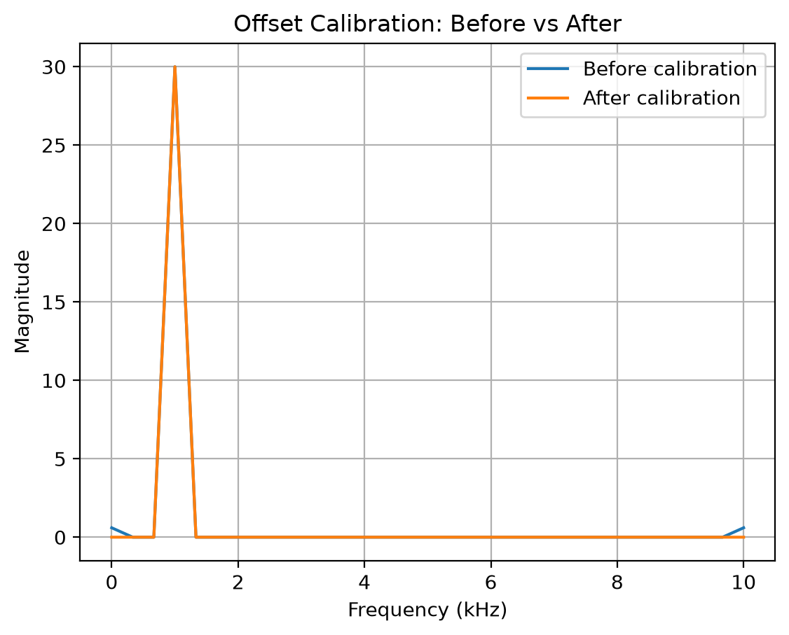
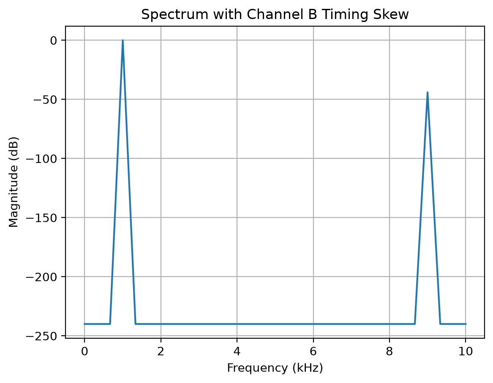

# 2-Channel Digitally Self-Calibrating Time-Interleaved ADC

This project simulates a two-channel time-interleaved ADC and investigates how analog channel mismatches appear in the sampled digital output.

The central idea is:

**Analog imperfection → digital error signature → parameter estimation → digital correction**


## What the simulation demonstrates

- 8-bit quantization
- 2-channel time interleaving
- gain mismatch
- offset mismatch
- FFT-based observation of mismatch spurs
- digital offset estimation and calibration
- timing skew and its dependence on input-signal slope


## Key results

- A 20 mV offset mismatch on Channel B created an unwanted 10 kHz spur in the FFT.
- Digital offset calibration removed the hardware error without damaging the real signal.
- Timing mismatch becomes increasingly dangerous as signal frequency rises, even when the clock skew itself stays fixed.
- A 2 µs Channel B timing skew produced a spur near 9 kHz, approximately 44 dB below the 1 kHz input tone.

## Engineering takeaway

In a time-interleaved ADC, analog imperfections such as channel offset or timing mismatch create recognizable errors in the digital output. By measuring those digital error signatures, we can estimate the underlying hardware mismatch and apply a digital correction. The goal of calibration is to remove the hardware-induced error while preserving the actual input signal.


## How to run

from the project directiory run ```python .\ADC.py```

required packages: numpy, matplotlib


## Results

### Offset calibration

The 20 mV Channel B offset creates a spur at 10 kHz. After estimating and subtracting the offset digitally, the spur is removed while the 1 kHz input tone is preserved.



### Timing skew

A 2 µs timing skew on Channel B creates a spur near 9 kHz for a 1 kHz input.


